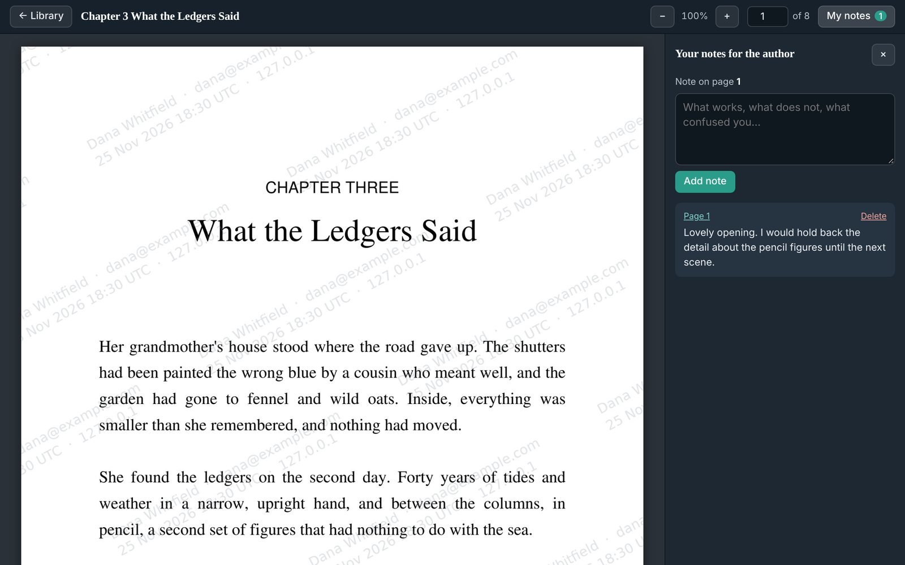
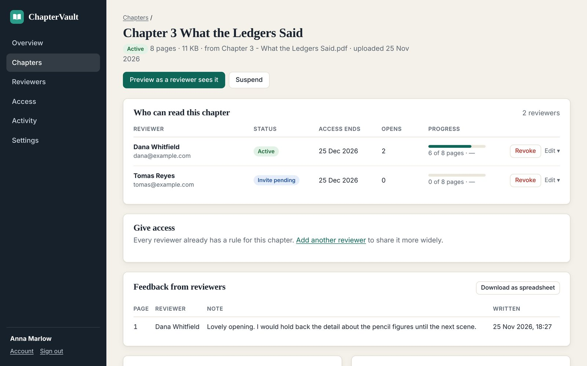

# ChapterVault

A private reading room for unpublished manuscripts. You upload only the chapters you want
reviewed, decide which reviewer may read which chapter and for how long, and take access away
again whenever you like. Reviewers read in their browser; the file itself never leaves the server.

| The reviewer's reader | The author's console |
|---|---|
|  |  |

## What it does

| | |
|---|---|
| **Upload selected chapters** | PDF, Word (`.docx`, `.doc`), OpenDocument, RTF, EPUB or plain text, several files at once. Uploading the whole book? Give a page range (`45-78`) and only those pages are kept. |
| **Encrypted storage** | Every chapter is encrypted with AES-256-GCM before it touches the disk. |
| **No file download** | Reviewers receive pages as images rendered on the server. There is no PDF to save, forward or open elsewhere. |
| **Personal watermark** | Each page is stamped with the reviewer's name, email address, the time and their IP address, so a leaked screenshot points at its source. |
| **Per-reviewer rules** | For each reviewer and chapter: a start date, an end date, a limit on the number of opens, and whether they may leave notes. |
| **Instant revocation** | Revoke one grant, suspend a chapter or suspend a reviewer. An open reader closes within about 20 seconds. |
| **Device locking** | An account works on a limited number of devices (2 by default) and only one session at a time, so a login cannot be passed around. |
| **Printing and copying blocked** | Printing produces a blank page; text selection, right-click, save and copy are disabled; the page is hidden when the window loses focus. |
| **Audit trail** | Sign-ins, every chapter opened, every page viewed, reading time, and each blocked print or copy attempt. Exportable as a spreadsheet. |
| **Reviewer feedback** | Reviewers attach notes to pages. You see them per chapter and can export them. |
| **Confidentiality terms** | Reviewers must accept your terms before they can open anything (editable, optional). |

## Run it on your computer

Requires Python 3.10 or newer.

```bash
cd chaptervault
python3 -m venv .venv && source .venv/bin/activate      # Windows: .venv\Scripts\activate
pip install -r requirements.txt
python run.py
```

The first start prints a one-time link:

```
No author account exists yet. Open this one-time link to create it:
  http://localhost:8000/setup?token=…
```

Open it, create your author account, and sign in.

Word files convert with their original layout if [LibreOffice](https://www.libreoffice.org) is
installed. Without it, `.docx` files still convert, but the text is re-flowed onto plain A4 pages;
exporting to PDF from Word first gives you exact control over what reviewers see.

## Using it

1. **Chapters → Upload chapters.** Pick the files. Each is converted, encrypted and listed.
   *Preview as a reviewer sees it* shows the watermarked result.
2. **Reviewers → Add a reviewer.** Enter a name and email, tick the chapters to share, and you get
   a personal invite link. Send it yourself (*Copy link* or *Write email*). The reviewer uses it once
   to choose a password.
3. **Access.** A grid of reviewers against chapters: tick to grant, untick to revoke. Open a chapter
   or a reviewer to fine-tune the dates and open limits of a single grant.
4. **Activity.** See who read what, how far they got, and anything that looked like a copy attempt.

If a reviewer changes computer or forgets their password, open their page and use
*Reset devices* or *Create password reset link*.

## Putting it online for reviewers

Reviewers need to reach the server over **HTTPS**. Do not expose it over plain HTTP: passwords and
pages would travel unencrypted.

On any server with Docker and a domain name pointing at it:

```bash
cd chaptervault
DOMAIN=review.example.com docker compose up -d --build
docker compose logs app      # shows the one-time setup link
```

This starts ChapterVault behind [Caddy](https://caddyserver.com), which obtains and renews the HTTPS
certificate automatically. The image includes LibreOffice for Word conversion.

Any other host works too: run `python run.py --host 0.0.0.0` behind a reverse proxy that terminates
TLS, and set `CHAPTERVAULT_BEHIND_PROXY=1` and `CHAPTERVAULT_BASE_URL`.

## Settings

| Environment variable | Purpose | Default |
|---|---|---|
| `CHAPTERVAULT_DATA` | Folder for the database, encrypted chapters and key | `./data` |
| `CHAPTERVAULT_BASE_URL` | Public address, used in invite links | taken from the request |
| `CHAPTERVAULT_BEHIND_PROXY` | Set to `1` behind a TLS-terminating proxy, so HTTPS and client IPs are detected | off |
| `CHAPTERVAULT_MASTER_KEY` | 32-byte key (url-safe base64). Keeps the key out of the data folder | generated in `data/master.key` |
| `CHAPTERVAULT_ADMIN_EMAIL`, `CHAPTERVAULT_ADMIN_PASSWORD`, `CHAPTERVAULT_ADMIN_NAME` | Create the author account at first start instead of using the setup link | unset |
| `CHAPTERVAULT_MAX_UPLOAD_MB` | Largest accepted upload | `200` |
| `PORT`, `CHAPTERVAULT_HOST` | Listening port and address | `8000`, `127.0.0.1` |

Defaults for new grants, the watermark text and strength, and the confidentiality terms are edited
in the app under **Settings**.

## Backups

Back up the whole data folder. `master.key` is the only thing that can decrypt the chapters: lose
it and they are unreadable; leak it together with the data folder and they are readable. For a
stricter setup, supply the key through `CHAPTERVAULT_MASTER_KEY` so it is stored apart from the data.

## What it protects against, and what it cannot

It stops the ordinary ways a manuscript gets passed on: there is no file to forward, no working
print or save, no shared logins, and access ends when you say so.

It runs in a web browser, so it **cannot physically stop** someone photographing their screen or
using a screenshot tool. Nothing browser-based can; dedicated DRM products close that gap by making
readers install a locked-down viewer application. ChapterVault's answer is deterrence and
traceability: every page a reviewer sees carries their own name, email address, time and IP
address across the text, the page is hidden when the window loses focus, and the log shows exactly
which pages each person opened.

Other limits worth knowing:

- Reading requires an internet connection; there is no offline mode.
- Device locking uses a browser cookie. Clearing cookies makes a browser look like a new device,
  which counts against the reviewer's device limit rather than bypassing it.
- The database (names, emails, notes, the activity log) is not encrypted; only the chapters are.

## Tests

```bash
pip install pytest
python -m pytest tests
```

The suite drives the real HTTP routes: encryption at rest, grant isolation between reviewers,
expiry, open limits, revocation of an open reader, device locking, single-session enforcement,
lockout, CSRF, and the author-only console.

## Licence note

ChapterVault renders pages with [PyMuPDF](https://pymupdf.readthedocs.io), which is licensed under
the AGPL. That is fine for running your own copy; read its terms before offering a modified version
to others as a hosted service.
